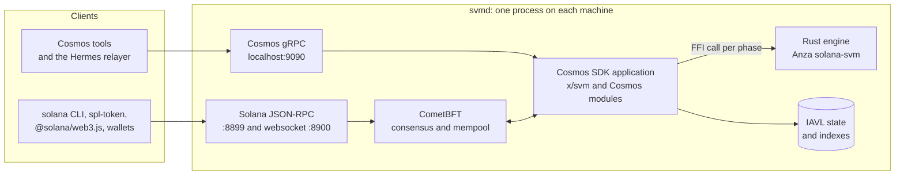

# Cosmos SVM

Cosmos SVM is a Cosmos SDK application chain. Its execution environment is the Solana Virtual Machine (SVM).

- Unmodified Solana mainnet programs load and run on this chain.
- The chain executes them with Anza's own `solana-svm` crate.
- Unmodified Solana client tools connect to the chain through Solana JSON-RPC.
- CometBFT gives each block instant finality.

Execution is bit-for-bit the same as on Solana mainnet. Block admission, rent, slot time and some RPC answers are different. [`docs/compatibility.md`](docs/compatibility.md) lists each difference. Read it before you deploy.

## How the parts connect

The Rust engine reads and executes transactions. It never writes state. The Go application writes all state. [`docs/architecture.md`](docs/architecture.md) shows how a transaction moves through these parts.

## Start here

| You want to | Read |
| --- | --- |
| Deploy a program, or connect a client or wallet | [`docs/developers.md`](docs/developers.md), then [`docs/compatibility.md`](docs/compatibility.md) |
| Operate a validator or an RPC node: hardware, settings, upgrades, governance and metrics | [`docs/runbook.md`](docs/runbook.md) |
| Run the chain and the services beside it as units | [`examples/`](examples/README.md): `svmd`, the IBC relayer, the ephemeral validator, the oracle, Hyperlane's agents, the crank turner, Prometheus and the gateway |
| Relay IBC packets to or from this chain | [`docs/runbook.md`](docs/runbook.md) |
| Understand the design | [`docs/architecture.md`](docs/architecture.md) |

## Requirements

| Item | Value |
| --- | --- |
| Operating system | Linux on x86_64. A validator refuses to start on other architectures. |
| Nix | [Install Nix](https://nixos.org/download/) with flakes on. `flake.nix` pins every other tool, for example Go 1.27, Rust 1.97.1, the Solana CLI 4.3.0, Anchor, and Node 22 with pnpm. |
| Validator hardware | 4 cores, 20 GB memory, 25 Mbps. See [`docs/runbook.md`](docs/runbook.md). |

If you do not use Nix, install these tools:

- Go 1.27.2 or later.
- The Rust version in `rust-toolchain.toml`.
- A C compiler, `make` and `perl`.
- For the acceptance runs, the tools that `flake.nix` lists.

NOTE: The flake does not give Docker. The settlement run needs it, because its Hyperlane e2e keeps a database in a container.

## Quick start

1. Enter the shell that has the pinned tools:

       nix develop

2. Get the pinned programs and build everything once:

       make setup

   `make setup` builds `bin/svmd`, `bin/svmd-devnet` and the third-party suites that the
   acceptance runs need. After it, the acceptance runs build nothing.

   NOTE: The first `make setup` takes about half an hour on four cores. It needs network access.

   To build one suite only, use `make prebuild PARTS=tuktuk`. [`docs/runbook.md`](docs/runbook.md)
   section 11 tells what each step does.

3. Build and test everything:

       make test

4. Make a one-machine chain with the devnet binary that `make setup` built:

       bin/svmd-devnet init my-validator --chain-id svm-local

5. In `~/.svmd/config/app.toml`, under `[svm]`, set `index-max-bytes` to a value that is not zero.
   For example, use `1073741824` (1 GiB).

   NOTE: The binary does not start until you set `index-max-bytes`.

6. Start the chain:

       bin/svmd-devnet start

7. Ask the chain for its block height:

       solana -u http://127.0.0.1:8899 block-height

## Make targets

| Target | What it does |
| --- | --- |
| `make setup` | Downloads the pinned programs, builds both node binaries, and builds every third-party suite the acceptance runs need. |
| `make prebuild` | Builds the third-party suites once, at the pins in `scripts/pins.sh`. `PARTS=js\|er\|tuktuk\|settle\|explorer\|ibc` builds some. |
| `make test` | Builds the engine, then runs the engine dependency check, the Rust tests, the Go tests with and without the `devnet` tag, and the bench report tests. |
| `make build` | Builds `bin/svmd` and `bin/svm-tpu`. |
| `make devnet` | Builds `bin/svmd-devnet`, the node with the devnet faucet. |
| `make lint` | Runs every linter that CI runs: `gofmt`, `go vet` with and without the `devnet` tag, and `shellcheck`. |
| `make accept-rpc` | Runs the unmodified Solana CLI, `spl-token` and web3.js against a local chain. |
| `make accept-clients` | Runs the pinned client suites headless: the Solana CLI, Agave's RpcClient, web3.js, kit, Anchor, two wallet sequences and the Solana Explorer. |
| `make accept-devnet` | Runs `solana airdrop` against a devnet binary. |
| `make accept-rollback` | Runs `svmd rollback` on one validator, then restarts it through the block it took back. |
| `make accept-consensus` | Runs four validators and a fifth machine through a restart, a join, a crash and a full block. |
| `make accept-ibc` | Moves a token from a stock ibc-go chain to this chain and back with Hermes. |
| `make accept-retention` | Runs one validator past 2,100 blocks and checks the evidence window. |
| `make accept-agreement` | Runs four in-process validators over 5,000 mixed blocks. |
| `make accept-er` | Runs MagicBlock's apps and test suites on Agave and on this chain, and judges this chain against Agave. |
| `make accept-settle` | Runs Hyperlane's e2e, SP1, RISC Zero and Squads on Agave and on this chain, and judges this chain against Agave. |
| `make accept-tuktuk` | Runs tuktuk's suite and the crank turner flows on Agave and on this chain, and judges this chain against Agave. |
| `make release` | Runs the release gate, then builds three binaries and three manifests. |
| `make bench` | Runs the microbenchmarks: the FFI crossings with Go's `testing.B` and `benchstat`, and SVM execution with Criterion. `make bench ARGS=list` lists the other suites. [`bench/README.md`](bench/README.md) explains them. |
| `make lint-shell` | Checks every shell script with `shellcheck`, as CI does. |
| `make clean` | Removes what the builds, the tests and the harnesses write. The run records under `rpc/accept/results` and `bench/results` stay. |

## Repository layout

| Path | Contents |
| --- | --- |
| `engine/` | The Rust engine. It links Anza's `solana-svm` and builds a static library. |
| `ffi/` | The Go side of the boundary between Go and the engine. |
| `x/svm/` | The Cosmos module: admission, block execution, state, indexes and feature gates. |
| `app/` | The Cosmos SDK application that joins the modules. |
| `rpc/` | The Solana JSON-RPC and websocket server. |
| `cmd/svmd/` | The `svmd` binary. |
| `genesis/` | The pinned mainnet programs and feature gates. |
| `internal/testchain/` | An in-process chain for tests. |
| `bench/` | Benchmarks. Their results support the numbers in the docs. |
| `tools/` | The oracles that link Anza's crates, Agave's RPC client suite, the QUIC client, the node tool that the harnesses use, and the RPC inventory generator. |
| `scripts/` | Release scripts, the engine dependency check, and the shell helpers that the harnesses share. |
| `docs/` | Documentation. |

## License

Apache License 2.0. See [`LICENSE`](LICENSE).
