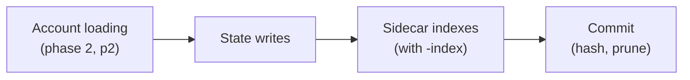

# Benchmark glossary

This page explains the words that the suites in `suites/` use. Read it before you read a suite or a
result. The [README](README.md) tells you how to run a suite.

## How to read a cell name

A cell name is a list of short parts, joined with `-`. Each part tells you one setting of the cell.

| Example | Read it as |
|---|---|
| `gl-10M-4M-int1-k4` | goleveldb, 10M accounts, a cache of 4M nodes, prune every block, 4 shards |
| `wi-20g-aged50` | the write shape with indexes, a 20 GiB cap, on the 50 GiB aged seed |
| `p2-hit-16g` | phase 2 (account loading), keys that exist, a 16 GiB cap |
| `wi-20g-gap400` | the write shape with indexes, a 20 GiB cap, 400 ms between blocks |

The parts:

| Part | Meaning |
|---|---|
| `gl`, `pb` | The database backend: goleveldb or Pebble. Some names spell it out: `iavl-cache-pebble`. |
| `iavl` | A cell of the store harness (`storage/`) |
| `10M`, `1M` | The number of accounts in state before the cell starts (`-preload`) |
| second `4M`, `1M` | The size of the node cache, in nodes (`-caches`) |
| `scale-N`, `export-N` | The same, written as a full number: `iavl-scale-5000000` has 5,000,000 accounts |
| `8g`, `16g`, `20g`, `28g` | The memory cap of the cell, in GiB. `28g` is the uncapped baseline. |
| `cache`, `prune`, `export`, `alloc`, `shard`, `read` | The store experiment that the cell runs (`-exp`, see [Store words](#store-words)) |
| `fast-hit` | One read case: through the fast node index, for keys that exist. The others are `fast-miss`, `descent-hit` and `descent-miss` (`-read-cells`). |
| `single`, `sharded` | The store harness on one tree, or on several shard trees (`-mode`) |
| `repro` | A copy of a cell from another suite, run again to check that its number repeats |
| `int1`, `int100` | Prune every 1 or every 100 blocks (`-prune-interval`) |
| `k1` to `k8` | The number of shards (`-shard-counts`) |
| `sync` | Prune inside the commit (`-sync-prune`) |
| `nofast` | The fast node index is off (`-no-fastnode`) |
| `hot` | The `hot-1pct` traffic pattern |
| `hit`, `miss` | The block loads keys that exist, or keys that do not exist (`-mode`) |
| `gap2s`, `gap400` | An idle time between the commit and the next block (`-gap`) |
| `aged`, `aged50` | The cell runs on an aged seed, sized by blocks or by 50 GiB |
| `rep` | A repeat of a cell from an earlier suite |
| `noindex` | The block does not write the sidecar indexes |

## Harness words

These words come from `bench.sh` and the suite files.

| Term | Meaning |
|---|---|
| Suite | One file in `suites/`. It lists the cells to run and the knobs that change them. |
| Cell | One measurement: one workload, at one configuration, with one memory cap. A cell writes `CELL.txt`. |
| `cell` | Runs any command as a cell. |
| `store_cell` | Runs a cell of the account store harness, `storage/`. |
| `blockcost_cell` | Runs a cell of the block cost harness, `blockcost/`. |
| Knob | A setting of a suite that you can change from the environment, for example `ROUNDS=60`. `bench.sh` shows each knob and its default. |
| `about` | The one-line description of a suite. |
| `needs` | The binaries that `bench.sh` builds before the suite runs. |
| `disk` | The suite measures a disk. You must give `--data DIR` on the disk that you want to measure. |
| Cap | The memory limit of a cell (`MemoryMax`, set through `systemd-run`). A cell with `-` has no cap. |
| Warmup | Blocks that the cell runs but does not measure. They fill the caches first (`-warmup`). |
| Rounds | The blocks that the cell measures (`-rounds`). |
| Label | The name of a cell in its result line (`-label`). `bench.sh compare` uses it to pair a new run with a reference run. |
| Seed | A database that a harness builds once and copies for each cell. The first cell builds it. This can take an hour. |
| Smoke | The `smoke` suite. It runs every harness at very small sizes to check the setup. Its numbers mean nothing. |
| Series | Per-block CSV files in `series/`. Use them to see if a cell reached a steady state. |

## Memory words

| Term | Meaning |
|---|---|
| Published minimum | The smallest machine that the docs tell a validator to use. A price comes from runs on this machine. |
| Ballast | Memory that a capped cell holds in place of the program cache of the engine. A suite cell holds 3 GiB. |
| `BALLAST=mmap` | The ballast is outside the Go heap, where the program cache really is. This is the default. |
| `BALLAST=heap` | The ballast is a Go allocation. It also raises the Go GC goal. Runs before 2026-11-07 used this. |
| `MALLOC=svmd` | glibc starts with the settings that `svmd` uses: `MALLOC_ARENA_MAX=4`, `MALLOC_TRIM_THRESHOLD_=131072`. |
| Page cache | File data that the kernel keeps in memory. A cap leaves less of it, so more reads go to the disk. |
| `BENCH_USER_SCOPE=1` | The cap runs in your own systemd scope, without sudo. Use it on a shared machine. |
| `BENCH_CPUS` | Pins a capped cell to some CPUs, for example `0-3`, so a large machine acts like the minimum one. |

Do not set a price from a run with `BENCH_USER_SCOPE` or `BENCH_CPUS`. Use those runs only to compare
two builds on the same machine.

## Store words

These words come from the account store (IAVL) and the `storage/` harness.

| Term | Meaning |
|---|---|
| IAVL | The Merkle tree that holds the accounts. Each block makes a new version of the tree. |
| Node cache | The tree nodes that IAVL keeps in memory (`-caches`, counted in nodes). |
| Fast node index | A flat index that finds an account without a walk down the tree. The chain ships with it on. |
| Descent | A lookup that walks down the tree. It is what a read does when the fast node index is off. |
| Preload | The accounts that the cell writes into state before it starts (`-preload`). |
| Keep-recent | The number of old versions that pruning keeps (`-keeps`). `0` keeps every version. |
| Pruning | The deletion of old tree versions. |
| Prune interval | How many blocks pass between two prunes (`-prune-interval`, app.toml `pruning-interval`). |
| Sync prune | Pruning runs inside the commit, not beside it (`-sync-prune`, app.toml `iavl-sync-pruning`). |
| Shard | The accounts are split across several trees by key. The chain ships eight shards. |
| Backend | The database under IAVL: Pebble, which the chain ships, or goleveldb. |
| `uniform` | Traffic where every account is equally likely. Every write is a cold random read. This is the worst case. |
| `hot-1pct` | Traffic where 1% of the accounts get 90% of the writes, like popular pools and mints. |
| `-exp cache` | Measures block time against the size of the node cache. |
| `-exp prune` | Measures pruning. |
| `-exp export` | Measures a full export of the state. |
| `-exp alloc` | Measures blocks that create new accounts. |
| `-exp shard` | Measures blocks against the number of shards. |
| `-exp read` | Measures one account lookup, with and without the fast node index. |
| Inter-block cache | An SDK cache that stays across blocks. `svmd` ships without it (`INTERBLOCK`). |

## Block cost words

These words come from `blockcost/` and the `block-limits` suite. The block cost harness times the
storage work of one block in four stages:

| Term | Meaning |
|---|---|
| Unit | The cost measure of a block. A block holds at most `MAX_BLOCK_UNITS`. The values are in `engine/src/cost.rs`. |
| Write lock | A writable account in a transaction. Its price is `WRITE_LOCK_UNITS` (`LOCK`). |
| Name | An account key that a transaction names. Its price is `NAME_UNITS` (`NAME`). A written account is also a name. |
| Shape | A block workload that fills the units with one kind of cost. The shapes are below. |
| Price | The units of one operation. `bench.sh report` turns the cell times into prices. |
| Sidecar indexes | The History, TokenIndex and Dedup indexes that a block writes beside the state (`-index`). |
| `history.db`, `tokens.db` | The databases of the History and TokenIndex sidecars. |
| Aged state | A seed that looks like a node that ran for a long time: a full history, then 300 blocks of writes. |
| Evidence window | The 2,000 blocks that every machine keeps (`min-retain-blocks`). The `aged` seed holds this many. |
| Arena | The memory that the engine gives to the accounts of one block: 512 MiB. A transaction loads at most 64 MiB. |
| Lookup table | An account that holds addresses. A v0 transaction names accounts through it. |
| Gap | An idle time between the commit and the next load (`-gap`). It stands in for `timeout_commit`. |
| `timeout_commit` | The CometBFT wait after a commit, before the next block. The chain ships 400 ms. |
| `COMMIT=serial` | The cell commits the stores one after another. |
| `COMMIT=app` | The cell commits the shards eight at a time, as the app does. |
| `OVERLAP` | The sidecar writes run beside the shard commit, not before it. It needs `COMMIT=app`. |
| `REST` | Large 10 MiB accounts that an aged cell plants and no block reads. They match the share of large accounts on mainnet. |
| Compile rate, prewarm | Two engine tests: how fast programs compile, and how much a warm program cache helps. |

The shapes of `block-limits`:

| Shape | The block is full of |
|---|---|
| `w` | Account writes |
| `wi` | Account writes, with the sidecar indexes. On an aged seed, `w` is `wi`. |
| `n` | Read-only names |
| `blk` | Transfers, the most common transaction |
| `a-big`, `a-mid` | New accounts of 10 MiB, or of 100 KiB |
| `tw` | Writes through one lookup table |
| `tr` | Lookup table reads |
| `ld` | Loads of 10 MiB accounts, to fill the arena |
| `ldw` | 50 large loads, and writes for the rest of the units |
| `pl`, `ldf`, `lwb` | Checks that explain `ldw`: large accounts that no block loads, large accounts far from the writes, and the `ldw` writes with 1 GiB more ballast |
