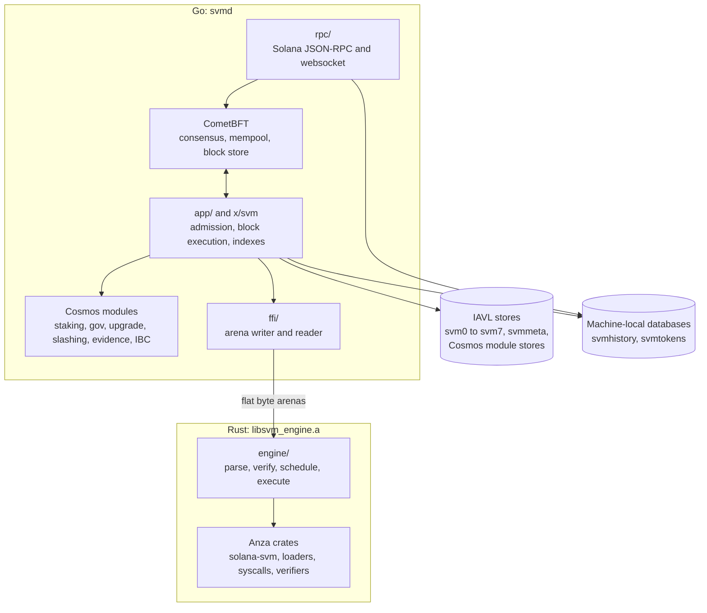
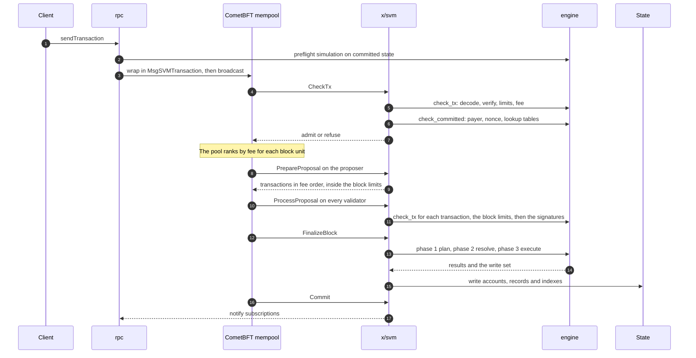
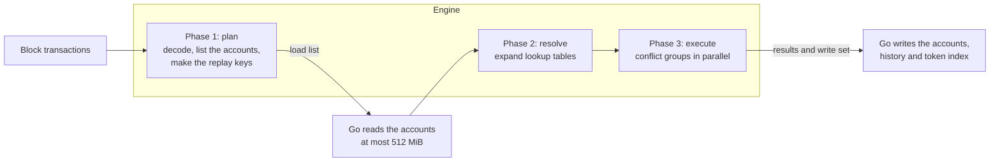
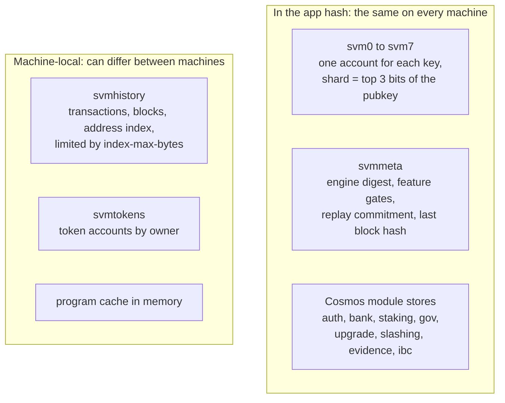
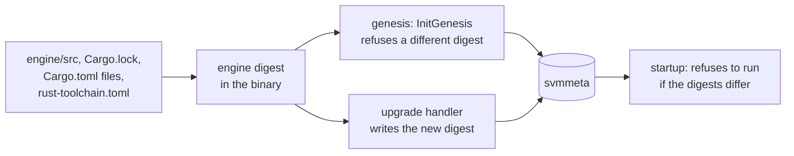

# Architecture

This page shows the parts of the chain and the path of a transaction through them. It is for operators, client developers and contributors.

## 1. One process, two languages

Each machine runs one process, `svmd`. It holds these parts:

The engine is a static library that the Go binary links through cgo. Go and Rust exchange flat
byte arenas, not pointers to each other's objects.

The engine never writes state. It reads accounts that Go gives it and returns the changes. Go is the only part that commits. This is the main safety rule of the project. If you do not know where code belongs, ask which side of this rule the code can damage.

## 2. The path of a transaction

1. **Send.** The RPC runs a preflight simulation, unless the client sets `skipPreflight`. Then the RPC wraps the Solana transaction in a Cosmos message, `MsgSVMTransaction`. It gives the message to the CometBFT mempool. Each handler finds the Solana transaction in the envelope by a byte match. It decodes only an envelope that does not match.
2. **Admit.** `CheckTx` has two halves. The first half needs only the transaction bytes. The second half reads committed state: the fee payer, the nonce account and the address lookup tables. Each check reads its own branch of one view of the height. All checks at that height share that view, and the view caches no read.
3. **Propose.** The proposer packs transactions in descending order of `total_fee * 1e6 / (cost + 1)` until a block limit stops it. It does not pack more fees for one payer than the payer can pay.
4. **Validate.** Every validator checks the proposal again with the first half of admission and with the block limits. This check reads no state, so all validators get the same answer. Last, it checks the signatures. It skips a transaction that this machine checked before, and refuses the whole proposal at the first bad signature.
5. **Execute.** The block runs in three engine phases.
6. **Commit.** Go writes the changed accounts to the IAVL stores. CometBFT commits the block. The block is final at once, so the RPC answers `finalized` for every commitment level.

## 3. The three phases of a block

- **Phase 1, plan.** The engine decodes each transaction and checks its signatures, unless this machine checked the same bytes before, at `CheckTx` or in `ProcessProposal`. It finds the accounts that the block names and gives Go one list without duplicates. It also gives Go one replay key for each transaction. Go marks each transaction that the chain processed before, so that the engine does not run it again.
- **Phase 2, resolve.** If a v0 message uses address lookup tables, the engine expands them. If a block has only legacy transactions, the engine skips this phase.
- **Go reads the accounts.** Go reads each account on the list from the IAVL stores, in a fixed order. It stops at 512 MiB. A transaction that names an account past that point fails with `MaxLoadedAccountsDataSizeExceeded`.
- **Phase 3, execute.** The engine puts the transactions in conflict groups. Two transactions conflict when one writes an account that the other reads or writes. Groups run in parallel, and each transaction runs on Anza's `solana-svm`.

The access list of a Solana transaction makes this possible. Each transaction declares every account that it reads or writes before it runs. The chain knows every conflict before it executes anything, so it never runs a transaction twice.

## 4. Where the state is

- **Accounts.** Each SVM account is one value in one of eight IAVL stores. The top three bits of the public key select the store.
- **Singletons.** `svmmeta` holds values that are not accounts. No account scan can see them.
- **Machine-local data.** The history index answers `getTransaction` and `getSignaturesForAddress`. The token index answers `getTokenAccountsByOwner`. A machine can delete or rebuild them. They are not part of consensus.

Lamports are not a Cosmos bank denom. They exist only in SVM accounts. The Cosmos side uses `usvm`, which only operators hold.

## 5. How the chain adopts an engine

All validators must execute with the same engine. The build computes a digest of every input that can change execution and puts it in the binary.

That is why a new engine always comes with an `x/upgrade` plan.

CAUTION: A machine that skips the plan keeps the old digest. It stops at an app hash mismatch.

A feature gate is different. The pinned crate already knows every gate, so a governance message can turn one on at a block height with no new binary.

## 6. Who decides what

| Change | How it happens | Example |
| --- | --- | --- |
| New engine or chain code | Binary upgrade with an `x/upgrade` plan | A new engine digest |
| Turn on a Solana feature | Governance message, at least 432,000 blocks ahead | Transaction V1, rent cuts |
| CometBFT consensus parameter | Governance message to `x/consensus` | `block.max_bytes` |
| Cache sizes, threads, RPC limits | Each operator, in `app.toml` or flags | `program-cache-bytes` |
