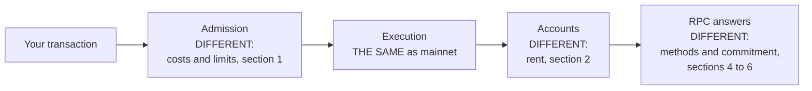

# What differs from Solana mainnet

This page is for the author of a program and for the developer of a client that talks to a program. Most rows apply to both readers.

Execution is bit-for-bit identical. Inclusion is not.

An unmodified mainnet program loads and runs here on Anza's own `solana-svm` 4.3.0. It uses Anza's own loaders, syscalls and verifiers. On every `make test`, a differential harness runs the full conformance corpus against Anza's crate. Your instruction executes exactly as on mainnet. It uses the same compute units and writes the same logs.

The differences are around execution:

## 1. A block costs more to fill, and names are not free

This chain charges for two things that Solana does not charge for. It charges about 14 times more for a third thing. All three are block admission, not execution. They decide if your transaction fits in a block, and the chain charges them before the transaction runs.

| Term | Here | Mainnet | What you observe |
|---|---|---|---|
| A write lock | 1,755 units | 300 units | A block holds 30,000 writable accounts where mainnet's holds 333,333 |
| Naming an account | 245 units | nothing | Every account that your message names, written or not, existing or not |
| Allocated bytes | `bytes / 2` units | nothing | A 10 MiB account allocation adds 5,242,880 units to all other costs |
| A deploy-capable transaction | `max(declared, 108,600) / 11` units | nothing | A deploy pays for the bytes that it declares, not the bytes that it writes |
| Accounts per transaction | 128 | 128 | The same. This is Solana's own `MAX_TX_ACCOUNT_LOCKS` |
| Units per block | 60,000,000 | 100,000,000 | Mainnet's limit comes from SIMD-0286. This chain keeps 60,000,000, because here the limit sets how long a full block takes to commit |
| Allocated bytes per block | 100,000,000 | 100,000,000 | The same |
| Units per writable account | 24,000,000 | 24,000,000 | The same. One account, also a fee payer, gets at most 40 percent of a block here and 24 percent on mainnet |

A write lock costs 1,755 units because a write here is a write to an IAVL tree. On Solana, a write goes to an index in memory, and a background task saves it later. The constant is the measured cost of the commit, divided into the latency budget of a block. It also includes the cost that a commit adds to the other reads in the block. We did not choose it. It is a measurement, and no policy can lower it.

Naming an account costs 245 units because this chain reads each named account before the block runs. The chain reads every account that a block names, one time, as one set. It reads each named account in all of these cases:

- if the account exists or not,
- if the transaction writes it or not,
- if the message names it directly or through an address lookup table.

Solana's index is a hash map in memory. The index of this chain is a read through a Merkle tree on disk, and this read has a cost.

In total, a default transfer costs 24,352 units here, so a full block carries 2,463 of them. Of that cost, 3,510 units are the two write locks and 735 units are the three names. The remainder is the signature, the declared compute and the loaded-data term, and those are Solana's own terms. That is the full effect on usual traffic. The effect on an unusual transaction can be large. A message that names 128 accounts pays 31,360 units for the names alone, which is the largest term in its cost.

A block counts the compute units that a transaction declares, not the units that it uses. The chain charges the block before the transaction runs, so what it charges is the limit the transaction set with `SetComputeUnitLimit`, or the default. Agave charges the same limit at admission, but after execution it gives the unused units back to the block. We do not. A transaction that declares much more than it uses fills a block here sooner than on mainnet.

For example, an ephemeral rollup commit declares 120,000 units and uses about 1,213. It costs 147,606 units of a block here, so a block holds about 406 commits. Set your limit near what your transaction uses. This difference stays.

A transaction cannot name the same account two times. This chain runs Solana's full `validate_account_locks` at admission and again in the block. The check includes the addresses that the lookup tables of a message resolve to. A duplicate fails with `AccountLoadedTwice`, as on mainnet.

A block loads at most 512 MiB of accounts, so a transaction can fail under its own limit. This chain reads the accounts of a block before the block runs, so it limits what one block can read. Each account counts as 64 bytes plus its data. This is Solana's own unit for the limit of one transaction. The accounts that a block reads as lookup tables have their own count of the same 512 MiB. An account with more than 8,248 bytes of data is not a table, and it does not count. The chain reads the accounts in a fixed order:

1. sysvars,
2. fee payers,
3. all other accounts, in the order that the transactions of the block first name them.

When the block reaches the limit, the chain does not read the accounts after that point. A transaction that names one of these accounts fails with `MaxLoadedAccountsDataSizeExceeded`, and it pays its fee. This is true even if the transaction stays under the limit that it declares. If the unread account is the fee payer or the nonce account, the chain does not process the transaction, and you can send it again. Solana reads accounts as each transaction needs them, so Solana has no such block limit.

## 2. Rent is mainnet's today, and a hardcoded constant can still be wrong

`Rent.lamports_per_byte` is 5,080 here, as on mainnet. If mainnet turns on a feature that changes this price, governance can turn it on here without a new binary. Until governance does this, the two prices differ.

Ask the chain. The chain serves `getMinimumBalanceForRentExemption`, and its answer is always correct. Like Agave, the method refuses a length of more than 10 MiB as an invalid request. 10 MiB is the largest account that a program can allocate.

CAUTION: Do not hardcode a rent value from mainnet documentation or from a mainnet deployment. Such a constant is the only way to get this value wrong. If the constant is lower than the price of this chain, account creation fails with `InsufficientFundsForRent`.

The rent floor for an account with zero bytes is 650,240 lamports here, as on mainnet. After a fee payer pays, it must keep that floor plus the fee. This is Solana's own rule.

## 3. A slot is a block, and a block takes 400 ms or more

`Clock.slot` is the CometBFT block height. They are the same number. An epoch is that number divided by `EpochSchedule.slots_per_epoch`.

A slot is about 400 ms when the chain is idle, and longer when a block is full. Each validator waits 400 ms after a commit before the next height. A full block adds the seconds that its commit takes on the machine the chain is priced for (runbook section 1). The interval is a default in the validator configuration, not a consensus rule, so a program must not depend on it. If you calculate time from a count of slots, the result is right on an idle chain and too short on a busy one.

Use `Clock.unix_timestamp` for a deadline in real time. Use the height for a count of blocks. This is also good advice on mainnet. Here, a timeout of 9,000 slots is one hour on an idle chain and ten hours at full blocks.

Windows that ephemeral rollups count in slots are counts of blocks here. On an idle chain each one is as long as on mainnet, and under full blocks each one is longer:

| Window | Slots | On an idle chain, and on mainnet | At full blocks of about 4 s |
| --- | --- | --- | --- |
| The owner program's timeout for an account that its validator never commits | 9,000 | about 1 hour | about 10 hours |
| A blockhash that a commit transaction uses | 150 | about 1 minute | about 10 minutes |
| A deactivated lookup table, before the validator can close it | 512 | about 3.4 minutes | about 34 minutes |
| A VRF oracle that genesis registers, before it can open its queues | 200 | about 1.3 minutes | about 13 minutes |
| A VRF request in a queue, before it expires | 240 | about 1.6 minutes | about 16 minutes |

The ephemeral validator also waits and polls on timers that assume 400 ms slots. The ephemeral rollup acceptance run passes with these timers unchanged.

The chain skips no slot. Heights have no gaps, so each height has a block. For this reason `SlotHistory` is not on this chain. Its answer here is always the same function of `Clock.slot`.

A leader is the CometBFT validator that proposes the block. The leader of slot s is the validator that proposes round 0 at height s. Its identity is its consensus key in base58. `getSlotLeaders`, `getLeaderSchedule` and `getBlockProduction` use this schedule. In the table, h is the latest committed height.

| Slots | Source | How certain |
|---|---|---|
| From the oldest retained height to h+1 | The validator sets that CometBFT kept | Exact |
| h+2 | The set of h+1, with the validator updates of block h | Certain |
| From h+3 to the end of the next epoch | CometBFT's proposer order, applied to the set of h+2 | A projection |

The projection stays true until a block changes the validator set. The change applies two heights after that block. Before the oldest retained height and after the end of the next epoch, there is no schedule. There, `getSlotLeaders` answers Agave's `-32602 Invalid slot range`, and `getLeaderSchedule` answers `null`.

The leader of a slot and the validator that made its block can be different. If round 0 fails, the proposer of a later round makes the block. `getSlotLeader` gives the validator that proposed the latest block. `getBlockProduction` counts that slot as a skip for the leader of round 0.

`getClusterNodes` lists each validator and the machine that answers. The network ports of a validator are not on the chain, so every field of a validator entry is `null` except `pubkey` and the QUIC fields. The entry of the machine that answers gives its own `rpc`, `pubsub` and `version`.

`tpuQuic` is the QUIC port of the machine that answers, on every entry. It is the address where that machine accepts transactions for each leader. It is not the leader's own port, so `solana gossip` shows every identity at one address. A transaction sent there enters the same pool as `sendTransaction` with `skipPreflight`, and the pool gossips it to every validator. That is why `solana program deploy` works without `--use-rpc`. A machine gives `tpuQuic` only while its QUIC port runs, and `null` otherwise.

`getEpochInfo` is exact. `absoluteSlot` and `blockHeight` are both the height. The epoch and the slot index come from the 432,000 slots of an epoch.

## 4. One commitment level, and what `processed` means

The three commitment levels become one level, `finalized`. CometBFT commits with instant finality, so a block that exists is final. There is no `processed` state that can roll back, and no separate `confirmed` state. If a request asks for `processed` or `confirmed`, the chain answers at `finalized`. That is stronger than the request.

`getBlock`, `getTransaction` and `getSignaturesForAddress` refuse `processed`, as Agave does: ``-32602 Method does not support commitment below `confirmed` ``. A `minContextSlot` above the latest committed height is Agave's `-32016`.

This costs a client latency, not correctness. On mainnet, a `processed` subscription sends early, and the chain can take it back. Here it sends when the block commits, and nothing takes it back. Code that treats a `processed` notification as provisional is correct, but slower than necessary. Code that waits for `finalized` after it sees `processed` waits for an event that already occurred.

## 5. Every Agave method and subscription, and how this chain answers it

Agave v4.3.0 serves 53 JSON-RPC methods and 9 websocket subscriptions. It always registers 12 methods, the "minimal" set. It registers the other 41 only with `--full-rpc-api`. Without that flag, Agave answers `-32601 Method not found` for them. The reference for this chain is a full-API Agave with transaction history. `solana-test-validator` runs this configuration.

The table gives each method and what this chain answers. "Served" means that the chain answers the method. A row with `-32601` means that the chain answers `Method not found`.

| Method | Agave set | Here today |
|---|---|---|
| `getBalance` | minimal | served |
| `getEpochInfo` | minimal | served |
| `getGenesisHash` | minimal | served |
| `getHealth` | minimal | served |
| `getIdentity` | minimal | served |
| `getSlot` | minimal | served |
| `getBlockHeight` | minimal | served |
| `getHighestSnapshotSlot` | minimal | served |
| `getTransactionCount` | minimal | served |
| `getVersion` | minimal | served |
| `getVoteAccounts` | minimal | served |
| `getLeaderSchedule` | minimal | served |
| `getMinimumBalanceForRentExemption` | bank | served |
| `getInflationGovernor` | bank | served |
| `getInflationRate` | bank | served |
| `getEpochSchedule` | bank | served |
| `getSlotLeader` | bank | served |
| `getSlotLeaders` | bank | served |
| `getAgGenesisCert` | bank | served |
| `getBlockProduction` | bank | served |
| `getAccountInfo` | accounts | served |
| `getMultipleAccounts` | accounts | served |
| `getBlockCommitment` | accounts | served |
| `getTokenAccountBalance` | accounts | served |
| `getTokenSupply` | accounts | served |
| `getProgramAccounts` | accounts-scan | served |
| `getLargestAccounts` | accounts-scan | served |
| `getSupply` | accounts-scan | served |
| `getTokenLargestAccounts` | accounts-scan | served |
| `getTokenAccountsByOwner` | accounts-scan | served |
| `getTokenAccountsByDelegate` | accounts-scan | served |
| `getInflationReward` | full | served |
| `getClusterNodes` | full | served |
| `getRecentPerformanceSamples` | full | served |
| `getSignatureStatuses` | full | served |
| `getMaxRetransmitSlot` | full | served |
| `getMaxShredInsertSlot` | full | served |
| `requestAirdrop` | full | served: `-32600 Invalid request` on a machine without a faucet, as Agave answers; the faucet on a devnet machine that holds a key |
| `sendTransaction` | full | served |
| `simulateTransaction` | full | served |
| `minimumLedgerSlot` | full | served |
| `getBlock` | full | served |
| `getBlockTime` | full | served |
| `getBlocks` | full | served |
| `getBlocksWithLimit` | full | served |
| `getTransaction` | full | served |
| `getSignaturesForAddress` | full | served |
| `getFirstAvailableBlock` | full | served |
| `getLatestBlockhash` | full | served |
| `isBlockhashValid` | full | served |
| `getFeeForMessage` | full | served |
| `getStakeMinimumDelegation` | full | `-32601`, kept: the Stake program is not on this chain |
| `getRecentPrioritizationFees` | full | served |

| Subscription | Here today |
|---|---|
| `accountSubscribe` | served |
| `blockSubscribe` | `-32601`, as a default Agave answers |
| `logsSubscribe` | served |
| `programSubscribe` | served |
| `rootSubscribe` | served |
| `signatureSubscribe` | served |
| `slotSubscribe` | served |
| `slotsUpdatesSubscribe` | served |
| `voteSubscribe` | `-32601`, as a default Agave answers |

A test keeps this table correct. It records the answers of `solana-test-validator` v4.3.0 to a corpus of requests. On each change, the test sends the same requests to this chain and compares the answers. A difference fails the test, unless a ledger in `rpc/testdata/transcript` keeps it with both values and the reason. The test also checks that this table lists each method in Agave's source, and says "served" exactly for the methods that this chain serves.

Know these six results before you write a client:

- A leader is a CometBFT validator, and there is no vote account, no stake and no inflation. The validators here are a permissioned CometBFT set, and the leader and epoch methods answer from its proposer schedule (section 3). `getVoteAccounts` answers two empty lists, and `getInflationGovernor` and `getInflationRate` answer zeros. `getInflationReward` answers `null` for each address when the boundary block of the epoch exists. Before that, it answers Agave's `-32004`, as a new Agave cluster does in its first epoch. No answer reports CometBFT voting power as stake. This chain does not serve `getStakeMinimumDelegation`, because its value is a rule of the Stake program, which is not on this chain.
- A browser may call the RPC from any origin, as on Agave. The HTTP layer is Agave's: the CORS headers, `OPTIONS`, the `405`, `415` and `413` texts, and `GET /health`, which answers `ok`, `behind` or `unknown` from the `getHealth` check. Agave has no setting for the origins, but here `svm.rpc-cors-origins` can limit both ports to a list of `scheme://host[:port]`. Then a page from any other origin gets `403`, and its request does not run. The default is `*`, which is Agave's answer. A client that is not a browser sends no `Origin`, and the setting does not affect it.
- The supply is every account's lamports, and all of it circulates. `getSupply` gives the running total of every account's lamports, which is Agave's capitalization. Each machine keeps the total in its token index and checks it with a full scan when it rebuilds the index. While the total is unknown, `getSupply` answers `-32005`, and the `/v0` supply paths answer `404`. `nonCirculatingAccounts` is empty and `nonCirculating` is 0. Agave lists mainnet's 214 non-circulating addresses on every cluster, but they are mainnet's own accounts, and nothing on this chain is locked.

  The stake half of Agave's rule is empty too, because no program on this chain writes stake account data. `getLargestAccounts` reads a full scan and keeps each answer for two hours, as Agave does.
- The transaction count is a counter in consensus state. `getTransactionCount` and `getEpochInfo.transactionCount` read it, so every validator gives the same number. It counts each SVM transaction since genesis that succeeded, or that failed and paid its fee. Agave also counts vote transactions, and this chain has none. Each machine samples `getRecentPerformanceSamples` every 60 s, as on Agave, and keeps and purges the samples with the history.
- `getSlot` is `getBlockHeight`. Both give the same number, and the chain serves both. A client that calls either one works.
- `sol_get_epoch_stake` answers zero for each vote account and for the total. There is no Solana stake to report. The code writes the zero explicitly and does not take it from a trait default. A difference between two machines here would stop the chain.

### Differences from Agave v4.3.0 today

The ledger keeps each of these with both values. A change that closes a difference deletes its ledger entries and changes this list.

- **Request framing and error texts.** The framing and its texts are Agave's. The request framing comes from jsonrpc-core, and the check on the number of parameters comes from jsonrpc-derive. Each refusal uses Agave's own text, with the reason that wincode gives for bytes that do not deserialize. When a parameter has the wrong type, the code is `-32602` and the text starts with `Invalid params: `, as on Agave. The description after that prefix is this chain's own. That difference stays.
- **Subscriptions.** With `enableReceivedNotification`, this machine sends `receivedSignature` when the block that holds the transaction reaches it, before the block commits. A single `solana-test-validator` leads each slot and receives no shreds, so it never sends one. An `accountSubscribe` on Clock, SlotHashes or RecentBlockhashes sends a notification at each block, as on Agave. When a gate activates, the chain writes the Rent sysvar or a feature account before the first transaction of its block. These writes send no notification, and Agave sends one. We keep it that way.
- **`costUnits`.** The chain always gives it, as Agave does, and it is the charge of the transaction against the block limit of this chain. The scale differs from Agave's in three ways. A write lock costs 1,755, not 300. Each account that the transaction names costs 245. The compute unit limit that the transaction requests counts, not the units that it uses. This stays too.
- **The HTTP layer.** This chain has no Agave genesis archive and no Agave snapshot, because CometBFT state sync does both jobs. So `/genesis.tar.bz2` and the snapshot paths answer `404` with no body, as Agave does for a file that it does not hold. This stays.
- **Leaders, epochs and the cluster.** The default range of `getBlockProduction` starts at height 1, because slot 0 is the genesis and holds no block. A `getClusterNodes` entry has no `gossip`, `tvu`, `tpuVote`, `serveRepair`, `shredVersion` or `clientId`, because this chain has none of them. `slotsUpdatesSubscribe` sends `completed`, `createdBank`, `optimisticConfirmation` and `root` at each commit. It never sends `frozen`, whose numbers count PoH entries.
- **Vote, stake and inflation.** `solana-test-validator` has a vote account, stake and an inflation schedule, so its `getVoteAccounts`, `getInflationGovernor` and `getInflationRate` report them. Here the lists are empty and the numbers are zero.
- **Kept differences.** An Agave block also holds a vote transaction and gives fee rewards, and a block here holds neither, because this chain has no vote accounts. In `base64+zstd`, the compressed bytes differ, and both decompress to the same data. `getHealth` uses a threshold of 8 blocks, and a machine with no peer that answers says `ok`. The caps on subscriptions are 1,024 for each connection and 1,024 connections, with Agave's refusal text. Accounts that the Stake, Vote and Config programs own have no `jsonParsed`, because those programs are not on this chain. These differences stay.
- **Simulation and preflight.** Every commitment answers the latest committed block, N. A simulation runs as the next block, N+1. It uses the gates that activate at N+1, a Clock at slot N+1 with the time of block N, and the SlotHashes and RecentBlockhashes of N+1. That is why a lookup table a client creates with the slot `getSlot` returned passes preflight, as on Agave. The context of the answer names N. A nonce that a simulation advances gets a value that no block writes, because block N+1 has no hash yet.
- **`getRecentPrioritizationFees`.** It gives the minimum price of each block for each address list. Agave gives the maximum for each address. That needs the writable keys of each transaction, and the engine does not export them.

## 6. `jsonParsed` covers six account owners, and the instructions of every program here

`jsonParsed` shows the accounts that these owners hold:

- SPL Token,
- Token-2022,
- the System program (nonce accounts),
- the address lookup table program,
- the upgradeable loader,
- the sysvar owner.

Agave parses nine programs. The three that this chain does not parse are Stake, Vote and Config. None of them is on this chain. All other owners fall back to base64. That is Agave's own answer for a program that it does not know.

The envelope is `{program, parsed, space}`, and its bytes are the same as Agave's. On every release, a test compares the output with `solana-account-decoder` as a golden-file oracle.

Each of the twenty-eight Token-2022 extensions shows as Agave shows it. An extension that does not unpack shows as `unparseableExtension`, which is Agave's own marker for the same case. The oracle test holds each extension, on a mint and on an account, to `solana-account-decoder`. `getTokenAccountBalance` also applies the interest-bearing and scaled amounts, as Agave does.

Transactions in `jsonParsed` parse the instructions of every program on this chain. The parsed programs are:

- System,
- SPL Token,
- Token-2022, with each extension instruction,
- the token group and token metadata interfaces,
- the Associated Token Account program,
- Memo v1, v3 and v4,
- both BPF loaders,
- the address lookup table program.

The parser reads the outer instructions, the inner instructions and the inner instructions of a simulation. An instruction that Agave cannot parse shows as partially decoded, which is Agave's own form. A test compares each instruction with Agave's renderer as a golden-file oracle.

One difference stays. An instruction to the Stake or the Vote program shows as partially decoded here, and Agave parses it. Neither program is on this chain, so such an instruction can only be in a transaction that failed.

## 7. Sysvars

Ten sysvar accounts are on this chain, and the bytes of eight are the same as on mainnet. These are the differences:

- `SlotHistory` is not on this chain. A program that takes this account does not load. Calculate the answer from `Clock.slot`. Heights have no gaps, so every bit below it is set.
- `StakeHistory` is empty, `LastRestartSlot` is 0, and `EpochRewards` is all zeros. Each value is true, not a placeholder. There is no Solana stake. A Cosmos upgrade never rolls back committed state, so no restart occurs. The chain distributes no rewards. `LastRestartSlot` stays 0, also across upgrades.
- `Fees` holds 5,000 lamports for each signature. Genesis writes it one time, and nothing writes it again. No syscall reads it. It is there so that a client that asks for the account gets mainnet's bytes, not null.
- `Rent.lamports_per_byte` is 5,080. That is mainnet's value. See section 2.
- `EpochSchedule` is mainnet's 432,000 slots, but a slot here is a block, so an epoch is a different length of real time. See section 3.

## 8. Which programs are on the chain, and how to add a program

Genesis puts these programs on the chain, at their mainnet addresses. Each one is the build that its project publishes as a GitHub release. Genesis downloads it and refuses a file whose sha256 is not the pin in `genesis/manifest.json`:

- the address lookup table program,
- the associated token account program,
- Memo v1, v3 and v4,
- SPL Token,
- Token-2022.

A program that has no release can come from mainnet. When you build genesis, the build reads the bytes of the program from mainnet. It refuses the bytes if their executable hash is not the pin. The executable hash is the hash that `solana-verify` reports. An account that a program needs can come from mainnet in the same way, pinned by the hash of its data. The repository does not keep these bytes.

Pyth Core is on every network, and no price feed is. Genesis puts both of Pyth's Solana id sets on the chain, with mainnet's bytes and no upgrade authority. Each set has the receiver, the Wormhole receiver and the push oracle:

- the default set: `rec5EKMG...`, `HDwcJBJX...`, `pythWSns...`,
- the pro-compatible set: `rec2HHDD...`, `HDw2E7P8...`, `pyt2F414...`.

For each set, genesis copies three accounts from mainnet, byte for byte: the receiver config, the Wormhole config and guardian set 1. Guardian set 1 holds Pyth's five router keys, and 3 of those 5 must sign each price that the chain accepts, as on Solana.

The fee is 0, so there is no treasury. Pyth's governance key never signs here, so the config stays as it is. To use a live feed, bring your own Pyth API key and push or pull updates. If Pyth changes its payloads, a new network must start with new pins.

Squads v4 is on every network. Genesis puts it at `SQDS4ep65T869zMMBKyuUq6aD6EgTu8psMjkvj52pCf` with mainnet's bytes, which have no upgrade authority on mainnet either. Its global config is not a copy of mainnet's. Genesis writes the same layout with a fee of 0, and an authority and a treasury at an address that nobody can sign for. On mainnet, the key of the Squads team can change the fee. Use the `@sqds/multisig` SDK or the Squads CLI with the RPC of this chain.

Helium's tuktuk is on every network. Genesis puts two programs on the chain, with mainnet's bytes and no upgrade authority: the tuktuk program `tuktukUrfhXT6ZT77QTU8RQtvgL967uRuVagWF57zVA` and its cron program `cronAjRZnJn3MTP3B9kE62NWDrjSuAPVXf9c4hu4grM`. Genesis also copies mainnet's tuktuk config and the IDL accounts of both programs, byte for byte. The initializer of the config accepts only Helium's key, so a new chain must copy the config. The authority of the config has no instruction in the program. Use `@helium/tuktuk-sdk`, `@helium/cron-sdk` and `tuktuk-cli` with the RPC of this chain.

A task runs only when a crank turner watches the chain. `tuktuk-crank-turner` is an external service, not part of this chain, and the operator of each network runs one (runbook section 14). The turner of the operator does not run a task that pays less than 10,000 lamports. A `RunTaskV0` pays 5,001 lamports and costs about 58,000 units against the block. A transaction that declares no compute budget costs about 232,000 (section 1). A cron job queues its transactions ahead of time. If you add the transactions after you create the job, the job skips its first execution.

The builtins are System, the three BPF loaders, Compute Budget and the ZK ElGamal proof program.

A network that admits ephemeral rollup validators has four more programs. `svmd init --ephemeral-validator` puts them in genesis, each with mainnet's bytes and no upgrade authority: MagicBlock's delegation program, the committor, SPL Noop and session keys. Without the flag, none of them is on the chain. An account that is delegated reads exactly as on Agave. `getAccountInfo`, `accountSubscribe` and `getProgramAccounts` show the delegation program as its owner, with its last committed state. A transaction that writes it fails as it fails on Agave. The methods of the Magic Router answer `-32601`, as on Agave.

The devnet program set is the production program set. A devnet here differs from production only in its chain ID, its faucet account and its build tag. Solana's own devnet also seeds no ecosystem programs. Each SPL program on each Solana cluster comes from a usual deploy transaction. The only cluster where Agave puts programs in by fiat is `Development`, which is `solana-test-validator`. The equivalent on this chain is `internal/testchain`, not its devnet.

On-chain token metadata and token groups already work, with no new genesis row. Token-2022 implements both interfaces in the program. It also has the `metadata_pointer`, `group_pointer` and `group_member_pointer` extensions that make them available.

To add a program, the chain must upgrade, and all four of these conditions must be true:

1. **A named dependent.** A specific client, test or integration needs the program. No program that is already on the chain can do the work. "Solana devnet has it" is not a dependent.
2. **Mainnet origin at a slot.** The bytes come from a mainnet deployment, pinned by address, hash and slot, as the existing programs are. You cannot add a program with no mainnet address, because there is nothing to pin it to.
3. **The program becomes immutable.** Genesis seeds each program with no upgrade authority. To add a program is to freeze the code of a different team at one slot, permanently. This condition refuses most programs.
4. **A conformance case runs on this runtime.** This chain runs SBPF, but that does not prove that a given program runs. The case goes into the corpus, and it runs on every release.

No other chain can call a program here. This chain can hold IBC channels, but nothing that comes through one becomes an SVM instruction. The only way to call your program is a signed Solana transaction, sent to the RPC of this chain. A design that expects an IBC packet, an interchain account or ICS27-GMP to reach a program does not work here.

## 9. How to know which chain you are on

Use the genesis hash. The chain serves `getGenesisHash`, and that hash identifies the chain. A validator refuses to start with a genesis hash that it does not expect.

No method at runtime reports the differences on this page. This is intentional, and Solana has no such method either. `getVersion` has two fields, and neither can say which feature gates are on. `solana feature status` needs methods that this chain does not serve. A client that must know that it is not on mainnet checks the genesis hash, and then reads this page.
