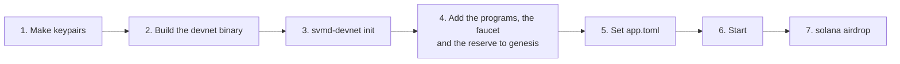
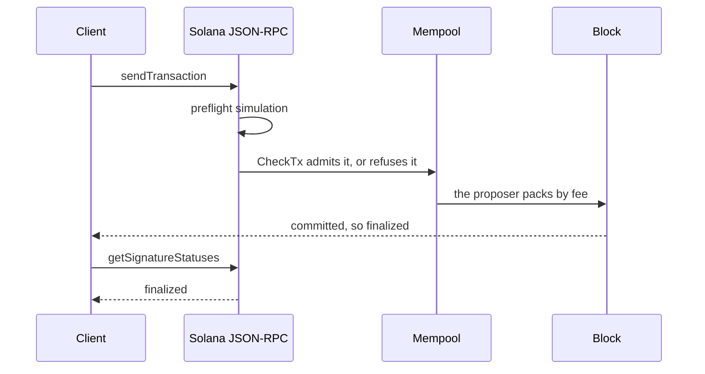

# Build on this chain

This page is for program authors and client developers. It tells you how to connect to the chain,
fund an account, deploy a program and send transactions.

Your program executes on this chain as it executes on Solana mainnet. Some rules around execution
are different. [`compatibility.md`](compatibility.md) lists each difference. Read it before you
deploy.

## 1. Connect

Each machine serves two endpoints:

| Endpoint | Default address | Flag that changes it |
| --- | --- | --- |
| Solana JSON-RPC | `http://127.0.0.1:8899` | `--svm.rpc-address` |
| Solana websocket | `ws://127.0.0.1:8900` | `--svm.ws-address` |

Use the unmodified `solana` CLI, `spl-token` CLI, `@solana/web3.js` or a wallet. Give the URL
explicitly. Do not change your global Solana configuration for a local chain:

    solana -u http://127.0.0.1:8899 block-height

You can also keep the settings in a separate file and give it with `-C`:

    solana config set -C ./local.yml --url http://127.0.0.1:8899 --keypair ./payer.json
    solana -C ./local.yml balance

NOTE: Some `solana` commands need a keypair, also when they only read, for example
`program show`. Give the keypair with `-k payer.json`, or use a `-C` file that names one.

NOTE: `@solana/web3.js` needs the websocket to confirm a transaction. If the websocket is not
available, web3.js waits and does not fall back to polling.

## 2. Make a local chain with a faucet

Only a devnet binary has a faucet. Do these steps on a Linux x86_64 machine with Go, Rust and the
Solana CLI installed.

1. Make a faucet key, a reserve key and a key for yourself:

       solana-keygen new --no-bip39-passphrase -s -o faucet_key.json
       solana-keygen new --no-bip39-passphrase -s -o reserve.json
       solana-keygen new --no-bip39-passphrase -s -o payer.json
       chmod 600 faucet_key.json

   NOTE: `svmd` refuses a faucet key that the group or other users can read. `chmod 600` prevents this.

2. Build the devnet binary from the repository root:

       make build
       go build -tags devnet -o ./svmd-devnet ./cmd/svmd

3. Make the chain:

       ./svmd-devnet init local --chain-id svm-devnet

4. Add the genesis programs, then give the faucet 1,000 SOL and the reserve 9,999,000 SOL:

       ./svmd-devnet add-genesis-programs genesis
       ./svmd-devnet add-genesis-account "$(solana-keygen pubkey faucet_key.json)" 1000
       ./svmd-devnet add-genesis-account "$(solana-keygen pubkey reserve.json)" 9999000

   Each `add-genesis-account` adds one System-owned account to `app_state.svm.accounts`. Nothing
   on the chain mints, so these two balances are the whole supply of your devnet.

5. In `~/.svmd/config/app.toml`, under `[svm]`, set these two values:

       index-max-bytes = 1073741824
       faucet-key = "/full/path/to/faucet_key.json"

6. Start the chain:

       ./svmd-devnet start

7. Fund your own account and look at the balance:

       solana -u http://127.0.0.1:8899 airdrop 10 "$(solana-keygen pubkey payer.json)"
       solana -u http://127.0.0.1:8899 balance "$(solana-keygen pubkey payer.json)"

The faucet has limits. By default, each caller address and each recipient gets:

- 5 requests and 20 SOL each minute.
- 200 requests and 200 SOL each day.
- 10 SOL at most in one airdrop.

The faucet refuses a request if the caller's count or the recipient's count would go over a limit.
A caller on the same machine (loopback) has no caller limit, as on Agave. The recipient limit stays.

[`runbook.md`](runbook.md) section 10 tells an operator how to change the limits and how to refill
the faucet.

## 3. Send a transaction

Send a transfer and confirm it:

    solana -u http://127.0.0.1:8899 -k payer.json transfer <recipient> 1.5 --allow-unfunded-recipient
    solana -u http://127.0.0.1:8899 confirm <signature>

The second command prints `Finalized`. This chain has one commitment level, `finalized`
([compatibility.md](compatibility.md) section 4). A block that exists is final, and nothing rolls
it back.

`sendTransaction` gives these refusals before the transaction enters the pool:

| Answer | Cause | What to do |
| --- | --- | --- |
| `-32002 Transaction simulation failed` | The preflight simulation failed. The error data holds the error and the logs. | Read the error data. Fix the transaction. |
| `-32003 Transaction signature verification failure` | A signature is not correct. | Sign the transaction again with the correct keys. |
| `-32002 Transaction rejected: ... blockhash not found` | The blockhash is too old. | Get a new blockhash with `getLatestBlockhash`, then sign again. |
| `-32002 Transaction rejected: ... fee payer cannot pay` | The payer cannot pay the fee and stay rent exempt. | Fund the payer. |

The last two come from the mempool. You see them when you set `skipPreflight`. Without
`skipPreflight`, the preflight simulation usually finds the same problem first.

## 4. Deploy a program

`solana program deploy` sends its writes over QUIC to the `tpuQuic` that `getClusterNodes` gives.
This works when the RPC machine runs its QUIC port. If `getClusterNodes` gives `tpuQuic: null`,
the port is off. Then add `--use-rpc`, and the CLI sends the writes through `sendTransaction`.

These commands make a program keypair, deploy the program and show it:

    solana-keygen new --no-bip39-passphrase -s -o program.json
    solana -u http://127.0.0.1:8899 -k payer.json program deploy \
        --program-id program.json ./target/deploy/my_program.so
    solana -u http://127.0.0.1:8899 -k payer.json program show "$(solana-keygen pubkey program.json)"

A deploy costs more block units here than on mainnet, because the chain charges for the bytes that
it declares ([compatibility.md](compatibility.md) section 1).

These SPL programs are already on the chain at their mainnet addresses, so do not deploy them
again:

- Token
- Token-2022
- Associated token accounts
- Memo
- Address lookup tables

## 5. Rules that change how you write a client

| Rule on this chain | What to do |
| --- | --- |
| Rent per byte is mainnet's today, and governance can change it with no new binary. | Ask `getMinimumBalanceForRentExemption`. Do not use a constant from mainnet. |
| A slot is a block. A block takes about 400 ms when the chain is idle and longer when it is full. | Use `Clock.unix_timestamp` for a time limit. Use the slot for a count of blocks. |
| There is one commitment level, `finalized`. | You can ask for `processed` or `confirmed`. The answer is always `finalized`. |
| A priority fee buys a place in the block. | Get the current price from `getRecentPrioritizationFees`. Set the price with `setComputeUnitPrice`. |
| An undeclared loaded-data limit costs 16,384 units. | Send `SetLoadedAccountsDataSizeLimit` with a real limit. At the same fee, your transaction then ranks higher. |
| Each account that a transaction names costs block units. | Name only the accounts the transaction uses. |
| The RPC serves 52 of Agave's 53 methods and 7 of its 9 subscriptions. | Do not depend on the three that answer `-32601`: `getStakeMinimumDelegation`, `blockSubscribe` and `voteSubscribe`. [compatibility.md](compatibility.md) section 5 lists each Agave method and what this chain answers. |
| No other chain can call your program. | Send a signed Solana transaction to the RPC. IBC packets do not become SVM instructions. |
| An ephemeral rollup app must name its validator. | When your app delegates an account, give a validator that the network admits. The delegation program compiles in a default, `MAS1Dt9qreoRMQ14YQuhg8UTZMMzDdKhmkZMECCzk57`. That default never commits here, so an account delegated to it stays delegated for 9,000 blocks. |

## 6. Find which chain you are on

Ask for the genesis hash:

    solana -u http://127.0.0.1:8899 genesis-hash

The genesis hash identifies the chain. No other RPC answer tells you that a chain is not mainnet.
